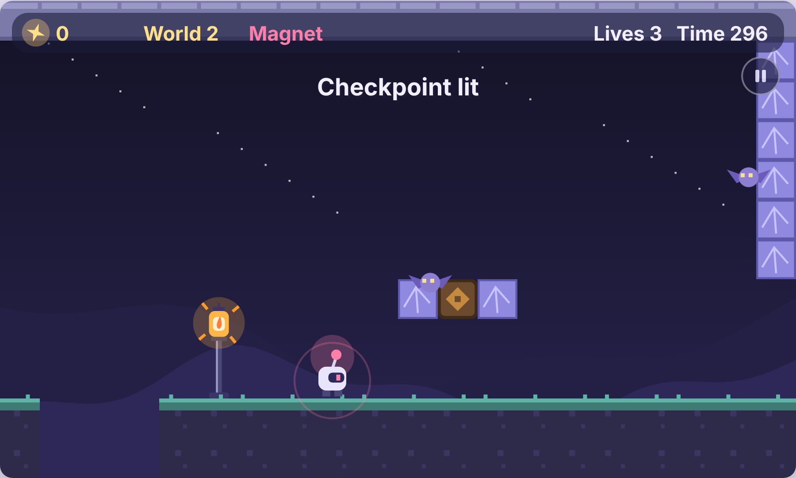
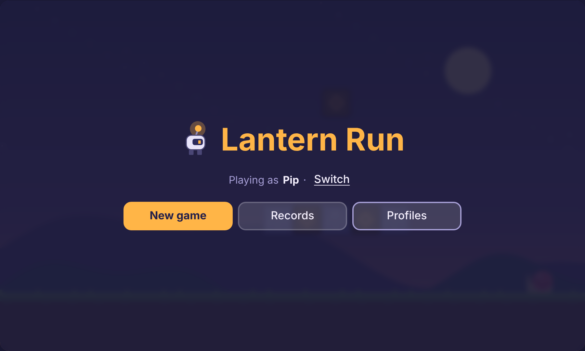
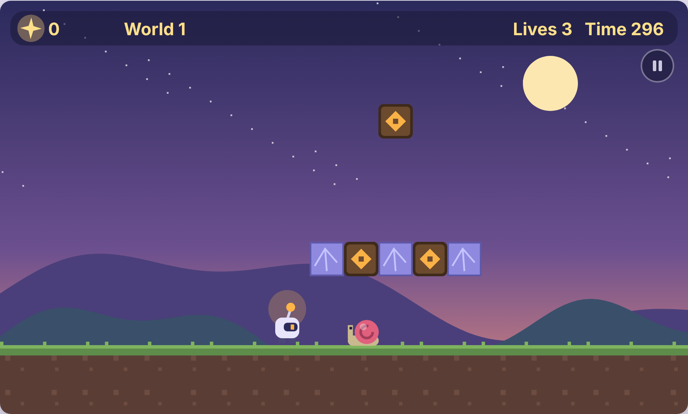
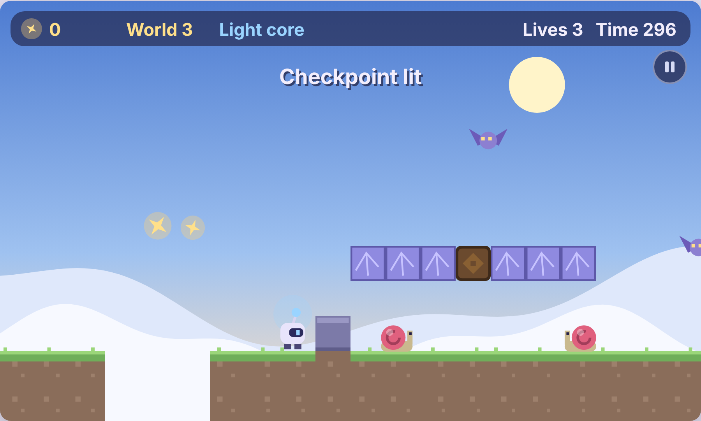

# Lantern Run

A small, cozy 2D platformer that lives in **one HTML file**. Guide **Pip**, a little lantern robot, through three worlds and light the great lantern at the end of each one.

No install, no build step, no dependencies. Open `index.html` in a browser and play, on desktop with a keyboard or on a phone with touch controls.

**▶ [Play it in your browser](https://krishnavijaykumar.github.io/lantern-run/)**



---

## Contents

- [How to play](#how-to-play)
- [Controls](#controls)
- [The worlds](#the-worlds)
- [Power-ups](#power-ups)
- [Enemies](#enemies)
- [Scoring](#scoring)
- [Lives, time and checkpoints](#lives-time-and-checkpoints)
- [Profiles, saves and records](#profiles-saves-and-records)
- [Accessibility](#accessibility)
- [Running it locally](#running-it-locally)
- [How the code is organised](#how-the-code-is-organised)
- [Making your own level](#making-your-own-level)
- [Contributing](#contributing)
- [Credits and license](#credits-and-license)

---

## How to play

Run right, jump over gaps, collect glowing **sparks**, and reach the **great lantern** at the far end of the world. Light all three lanterns to win.

Along the way, bump the glowing **lantern boxes** from below to release sparks or a **power-up**. Purple **crystal bricks** shatter when you hit them from below or shoot them.

<p align="center">
  
  
</p>

## Controls

| Action | Keyboard | Touch |
|---|---|---|
| Move | ← → or A / D | ◀ ▶ |
| Jump | Space, ↑ or W | ⤒ |
| Shoot light (needs the Light core) | X, K or F | ✦ |
| Pause / resume | P or Esc | ❚❚ |

Movement has a bit of polish to make it feel fair:

- **Variable jump height.** Hold jump to go higher, tap it for a short hop.
- **Coyote time.** You can still jump for a few frames after running off a ledge.
- **Jump buffering.** Press jump slightly before landing and it still counts.
- **Stomp bounce.** Landing on an enemy bounces you up, higher if you're holding jump.

## The worlds

| # | World | Feel | Power-ups found here |
|---|---|---|---|
| 1 | **Dusk Meadow** | Sunset hills, gentle introduction | Battery, Glide leaf |
| 2 | **Crystal Caves** | Dark, low ceiling, bats appear | Magnet, Light core, Battery |
| 3 | **Sky Ruins** | Bright sky, many gaps, the hardest jumps | Glide leaf, Light core, Battery |

<p align="center">
  
</p>

## Power-ups

You hold **one power at a time**. Picking up a new one replaces the old one. Pip's antenna glows in the power's colour.

| Power | What it does |
|---|---|
| 🔋 **Battery** | Double jump: jump once more in mid-air. |
| 🍃 **Glide leaf** | Hold jump while falling to float down slowly. |
| 🧲 **Magnet** | Nearby sparks fly to you. |
| 🔵 **Light core** | Shoot bolts of light that defeat enemies and break crystal bricks (up to two on screen at once). |

A power-up also works as a shield. If you get hit while holding one, you lose the power instead of a life and blink for a moment of safety.

## Enemies

| Enemy | Behaviour | How to beat it |
|---|---|---|
| 🐌 **Snail** | Crawls along the ground and turns at walls and ledges. | Stomp it, shoot it, or bump the block it's standing on from below. |
| 🦇 **Bat** | Flies back and forth in a wavy pattern. | Stomp it or shoot it. |

## Scoring

| Event | Points |
|---|---|
| Collect a spark | 10 |
| Spark from a lantern box | 10 |
| Break a crystal brick | 20 |
| Defeat an enemy | 50 |
| Pick up a power-up | 100 |
| Reach the lantern | 5 × seconds left on the clock |

Finishing fast pays off: the time bonus is often the biggest chunk of a world's score.

## Lives, time and checkpoints

- You start with **3 lives**. Falling into a gap, running out of time, or getting hit without a power-up costs one.
- Each world has a **300-second** timer.
- **Checkpoint lanterns** along the way light up as you pass them. After losing a life you restart at the furthest one you've lit.
- Lose your last life and it's **Out of lives**. You can retry the same world with 3 fresh lives and a score of 0.

## Profiles, saves and records

The game keeps everything **on your device** in the browser's local storage. Nothing is sent anywhere.

- **Profiles.** Up to 5 players per device, each with a name up to 12 characters. Handy for families or friends sharing one computer.
- **Continue.** Your progress is saved at the start of each world. *Continue* restarts that world with the score, lives and power you entered it with.
- **Records.** Each profile tracks its best score, furthest world, total runs and the last 10 runs (date, world, score and whether you won).
- Profiles can be reset (records wiped, profile kept) or deleted.

If storage is unavailable (for example in some private browsing modes) the game still works and shows a notice that progress won't be saved.

## Accessibility

- Full keyboard navigation through every menu: Tab, arrow keys, Enter and Esc. Focus is trapped inside open menus and dialogs.
- Screen reader announcements for pausing, the resume countdown, clearing a world, winning and game over.
- Follows your system's **light or dark** theme for menus.
- Touch buttons are large (70–86 px) and the pause button sits away from the jump button, so a slipping thumb doesn't pause the game.
- The game **auto-pauses** when you switch tabs or windows, and resumes with a 3-2-1 countdown so you're never dropped back into action cold.

## Running it locally

Download `index.html` and open it in any modern browser. That's it.

To serve it locally instead (useful on a phone on the same Wi-Fi):

```bash
git clone https://github.com/krishnavijaykumar/lantern-run.git
cd lantern-run
python3 -m http.server 8000
# then open http://localhost:8000
```

The only network request is for the [Fredoka](https://fonts.google.com/specimen/Fredoka) font from Google Fonts. Offline, the game falls back to your system font and plays the same.

## How the code is organised

Everything is in `index.html`: CSS, then two scripts.

| Part | What it does |
|---|---|
| **Game engine** (first `<script>`) | Level data, tile grid, physics and collision, input, enemies, power-ups, scoring, saving, and drawing on a `<canvas>`. |
| **Menu UI** (second `<script>`) | HTML menus layered over the canvas: profiles, main menu, pause, records, confirm dialogs. It talks to the engine only through a small public API (`window.__game.api`). |

Some technical details:

- The game draws at a fixed **400 × 240** internal resolution and scales to fit the screen, so it stays crisp on high-DPI displays.
- The world is a grid of **20 px tiles**, **12 rows** tall.
- Physics runs at a fixed **60 updates per second**, independent of the display's refresh rate.
- `window.__game` exposes the game state and an `update()` step function. It's there so automated tests can drive the game frame by frame, and it's harmless in normal play.

## Making your own level

Levels are short scripts in the `LEVELS` array. Each one has a name, a width in columns, a colour theme, and a `build` function that places things on the grid. Columns count from the left; rows count from the top, with 0 at the top and 11 at the bottom.

```js
{ name: 'My World', cols: 120,
  theme: { sky: ['#2b2a5c','#6b4f8f','#e38b7a'], hills: ['#4a3f7a','#3a4f6a'],
           grass: ['#5e8c4a','#7fb35f'], soil: ['#5a3e36','#6d4c41'], orb: '#fde7b0', stars: 40 },
  build(L) {
    L.ground(0, 40); L.ground(44, 120);   // ground from column a to b (gap between 41–43)
    L.row(10, 14, 8);                      // sparks across columns 10–14 on row 8
    L.brick(18, 19, 7); L.box(20, 7, 'battery'); L.brick(21, 22, 7);
    L.snail(30); L.bat(50, 5);
    L.check(60);                           // checkpoint lantern
    L.goal(110);                           // the great lantern
  }}
```

| Builder | Places |
|---|---|
| `ground(a, b, h=2)` | Solid ground from column `a` to `b`, `h` tiles tall |
| `plat(a, b, y)` | Wooden platform on row `y` |
| `stack(x, h)` | Stone pillar `h` tiles tall, standing on the ground |
| `brick(a, b, y)` | Breakable crystal bricks on row `y` |
| `box(x, y, content)` | Lantern box holding `'spark'`, `'battery'`, `'leaf'`, `'magnet'` or `'core'` |
| `ceiling()` | Solid stone along the top row |
| `row(a, b, y)` | A line of sparks on row `y` |
| `snail(x)` | A snail on the ground at column `x` |
| `bat(x, row)` | A bat circling around column `x` at row `row` |
| `check(x)` | A checkpoint lantern |
| `goal(x)` | The great lantern that ends the world |

Add your level to the end of `LEVELS` and the game picks it up as the next world.

## Contributing

Ideas, bug reports and new levels are welcome.

- **Found a bug?** Open an issue with what you did, what you expected, and your browser and device.
- **Made a level?** Open a pull request that adds it to `LEVELS`, with a screenshot.
- Please keep the game a single, dependency-free HTML file. That's part of its charm.

## Credits and license

Created by **Gangisetty Krishna Vijay Kumar**.

The [Fredoka](https://fonts.google.com/specimen/Fredoka) font is loaded from Google Fonts and is licensed under the SIL Open Font License.

Lantern Run is released under the [MIT License](LICENSE). You're free to play it, share it, change it and build on it.
